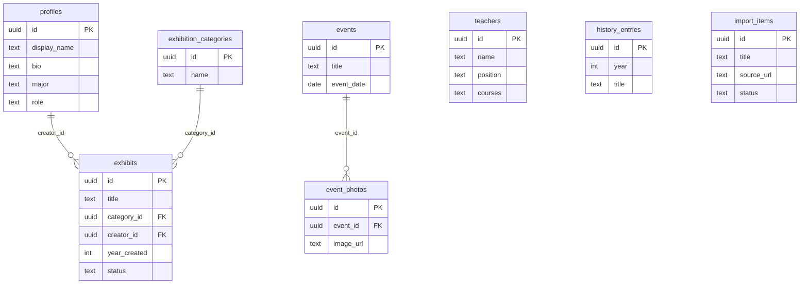

# ISM Digital Museum

ISM тэнхимийн түүх, багш, арга хэмжээ, оюутны бүтээлийг хадгалж, танилцуулах интерактив музей. Internet Programming · Гэрийн даалгавар №1.

## Технологи
- React 18 + JavaScript + Vite + React Router
- Supabase Auth, PostgreSQL, Storage, Row Level Security
- GitHub + Vercel

## Хэрэгжүүлсэн боломжууд
- Дижитал үзэсгэлэн: жагсаалт, дэлгэрэнгүй, ангилал/он/нэр/тайлбар/технологиор хайх, шүүх.
- Багшийн танилцуулга; арга хэмжээний жагсаалт, дэлгэрэнгүй болон зурагт цомгийн lightbox.
- ISM Time Machine: түүх, арга хэмжээ, үзмэрийг он цагийн дарааллаар харуулах, оноор шүүх.
- Бүртгэл, нэвтрэх, гарах; хэрэглэгчийн profile.
- Оюутны өөрийн бүтээлийн CRUD; Supabase Storage-д зураг хадгалах.
- Админ CRUD: багш, арга хэмжээ, зурагт цомог, түүхэн бичлэг, ангилал.
- Responsive dark museum дизайн, keyboard-accessible controls, хоосон/алдааны төлөв.

## Эхлүүлэх
1. `npm install`
2. `.env.example` файлыг хуулж `.env` нэртэй болгоно.
3. Supabase Project URL болон Publishable key (эсвэл legacy anon key)-г `.env`-д оруулна:

```env
VITE_SUPABASE_URL=https://YOUR_PROJECT.supabase.co
VITE_SUPABASE_ANON_KEY=YOUR_SUPABASE_PUBLISHABLE_OR_ANON_KEY
```

4. Supabase Dashboard → SQL Editor дээр `supabase/schema.sql`-г **шинэ/хоосон төсөл дээр нэг удаа** бүтнээр ажиллуулна.
5. `npm run dev`.
6. Нэвтэрч хэрэглэгч үүсгэсний дараа Supabase → Authentication → Users хэсгээс тухайн хэрэглэгчийн UUID-г авч SQL Editor дээр админ болгоно:

```sql
update public.profiles set role = 'admin' where id = 'USER_UUID_HERE';
```

## Өгөгдлийн сангийн холбоос
- `auth.users (1) → profiles (1)` — хэрэглэгчийн profile.
- `profiles (1) → exhibits (many)` — бүтээлийн эзэмшигч (`creator_id`).
- `exhibition_categories (1) → exhibits (many)` — ангилал (`category_id`).
- `events (1) → event_photos (many)` — арга хэмжээний зурагт цомог (`event_id`).
- `teachers`, `history_entries` — тусдаа лавлах/түүхийн хүснэгт.

`id` талбарууд UUID primary key; дээрх холбоосууд foreign key. `schema.sql` нь RLS идэвхжүүлж, нийтэд унших эрх ба эзэмшигч/админы бичих эрхийг тусгаарлана. Profile-ийн role-ийг энгийн хэрэглэгч өөрөө өөрчилж болохгүй. Storage-ийн `images` bucket-д хэрэглэгч зөвхөн өөрийн UUID хавтас (`<uid>/...`) руу upload хийнэ.

## Чухал өгөгдлийн тэмдэглэл
Даалгаврын PDF-д бодит багшийн нэр, арга хэмжээний огноо, оюутны бүтээлийн жагсаалт өгөөгүй. Иймээс бодит мэт зохиомол багш/арга хэмжээний мэдээлэл нэмээгүй. Ангилал болон timeline дахь seed бичлэгүүд нь жишээ/засварлах өгөгдөл; тэнхимийн баталгаатай мэдээллээр солих шаардлагатай.

## Vercel
- GitHub repository-г Vercel-д Import.
- Framework: Vite; Build: `npm run build`; Output: `dist`.
- Environment Variables-д `VITE_SUPABASE_URL`, `VITE_SUPABASE_ANON_KEY` нэмнэ.
- Deploy хийсний дараа Supabase Authentication → URL Configuration дээр Site URL болон Redirect URL-д Vercel domain-оо тохируулна.
- `.env`-г GitHub-д хэзээ ч commit хийхгүй. Frontend-д зөвхөн publishable/anon key ашиглана; `service_role`/secret key-г хэзээ ч оруулахгүй.

## v2 шинэчлэл
- **ISM Creators** (`/creators`, `/creators/:id`): оюутны профайл (нэр, хөтөлбөр, танилцуулга, зураг, GitHub) болон бүтээлүүдийг холбоно; профайлаа «Миний бүтээл» хуудаснаас засна.
- **Тэнхимийн түүх** (`/history`): түүхэн үйл явдлыг арван жилийн үе шатаар харуулна.
- Үзмэрийг бүтээгчийн нэрээр хайх, технологиор (chip) шүүх, үр дүнгийн тоо, «Шүүлтүүр цэвэрлэх».
- Админ самбар: **Үзмэр хянах** (бүх үзмэр, ноорог/нийтлэгдсэн) ба **UFE импорт** (`import_items` хянах).
- **Technology Evolution** (Time Machine хуудсанд): хамгийн их ашигласан технологи (bar chart) ба он × технологийн heatmap.
- `api/import-ufe.js` ESM болгож засав; `vercel.json` нь `/api/*`-г SPA rewrite-аас чөлөөлнө.

### Өгөгдлийн сан шинэчлэх
Schema-г өмнө нь ажиллуулсан бол Supabase SQL Editor дээр `supabase/migration_v2.sql`-г ажиллуулна (profiles-ийн шинэ баганууд, `import_items` + RLS). Demo өгөгдөл: `supabase/seed_demo.sql`.

### ERD

